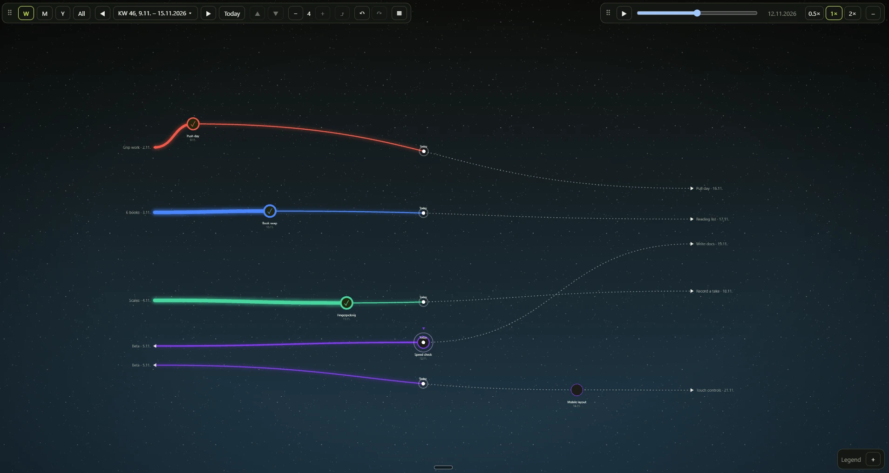
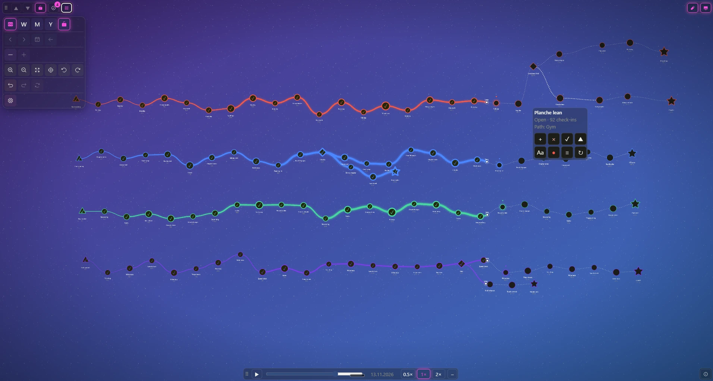

<div align="center">

# World of Evolving Paths

**A canvas for paths with dates. The more you walk a path, the stronger it gets.**

[](https://www.npmjs.com/package/world-of-evolving-paths)
[](LICENSE)
[](#1-install)
[](https://marcus-koch-fs-dev.github.io/world-of-evolving-paths/)

[Live demo](https://marcus-koch-fs-dev.github.io/world-of-evolving-paths/) · [StackBlitz](https://stackblitz.com/github/marcus-koch-fs-dev/world-of-evolving-paths?view=preview) · [Changelog](CHANGELOG.md)

 

</div>

Milestones, branches and goals on a pannable, zoomable canvas. Like a skill tree that is also a calendar.

It is a library, not an app. Your app owns the data. The library draws it and tells you what the user changed. The map works with any framework, and a React binding is included.

## Walk the path

A path gets stronger the more often you walk it. A day on which you walked it is a **check-in**. The line to your next point gets thicker and starts to glow:

| Tier | Name        | Check-in days in 12 weeks | Meaning                   |
| ---- | ----------- | ------------------------- | ------------------------- |
| 0    | Desire path | 0                         | just started              |
| 1    | Path        | 6                         | about once a week         |
| 2    | Road        | 18                        | two or three times a week |
| 3    | Expressway  | 40                        | most days                 |
| 4    | Highway     | 70                        | nearly every day          |

A highway is a real habit. It shrinks slowly when you stop. See [Strength in code](#strength-in-code).

> [!IMPORTANT]
> **Coming from 0.0.x?** 0.1.0 is a breaking change: the data model is new. See [Migrating](#8-migrating-from-00x).

## Contents

**Start**

1. [Install](#1-install)
2. [Quick start](#2-quick-start)

**Editor** (what the user does)

3. [Using the demo editor](#3-using-the-demo-editor)
4. [Views and levels](#4-views-and-levels)

**Your data** (what you do)

5. [Data model](#5-data-model)
6. [Save and load your data](#6-save-and-load-your-data)

**More**

7. [Reference](#7-reference)
8. [Migrating from 0.0.x](#8-migrating-from-00x)
9. [Roadmap](#9-roadmap)
10. [Contributing](#10-contributing)

## 1. Install

```bash
npm install world-of-evolving-paths
```

`pixi.js` comes with it. `react` and `react-dom` (18 or newer) are optional and only needed for `world-of-evolving-paths/react`. Node.js 24 or newer.

## 2. Quick start

### With React

```tsx
import { useState } from 'react';
import { createStore, periodOf } from 'world-of-evolving-paths';
import { PathWorld, ZoomControls } from 'world-of-evolving-paths/react';
import 'world-of-evolving-paths/style.css';

const period = periodOf('week', '2026-11-04');

// Your data: paths, each with branches, each with points in time order
const start = createStore([
  {
    id: 'combat',
    name: 'Combat',
    color: '#ff3b3b',
    branches: [
      {
        id: 'combat-main',
        points: [
          { id: 'a', date: '2026-11-02', title: 'Sword basics', kind: 'start', status: 'done', prio: 5 },
          { id: 'b', date: '2026-11-05', title: 'Parry', kind: 'milestone', status: 'current', prio: 2 },
        ],
      },
      // A fork: a branch that leaves from a point of another branch
      {
        id: 'combat-shield',
        splitsAt: 'a',
        points: [{ id: 'c', date: '2026-11-06', title: 'Shield', kind: 'goal', status: 'open', prio: 3 }],
      },
    ],
  },
]);

export function Example() {
  const [store, setStore] = useState(start);
  return (
    <div style={{ width: '100vw', height: '100vh' }}>
      {/* The map hands you a new store whenever the user changes something. Keep it. */}
      <PathWorld store={store} onStoreChange={setStore} view={period.key}>
        <ZoomControls />
      </PathWorld>
    </div>
  );
}
```

`PathWorld` fills its parent, so give the parent a size.

### Without a framework

```ts
import { createPathWorld, createStore, periodOf, type PathWorldOptions } from 'world-of-evolving-paths';

const period = periodOf('week', '2026-11-04');
let store = createStore([
  /* your paths, as above */
]);

// The element needs a size, the map fills it
const element = document.getElementById('map')!;

const options = (): PathWorldOptions => ({
  store,
  view: period.key,
  onStoreChange: (next) => {
    store = next; // keep it, then pass it back in
    handle.update(options());
  },
});

const handle = createPathWorld(element, options());

// When you remove the element:
handle.destroy();
```

> [!IMPORTANT]
> `handle.update(options)` replaces all options, it does not merge them. Always pass the full set, callbacks included. Without `onStoreChange` nothing can be moved.

The stylesheet is only needed for the React binding and its controls.

## 3. Using the demo editor

What the user can do in the [live demo](https://marcus-koch-fs-dev.github.io/world-of-evolving-paths/). Built into the map: select, drag, zoom, **M** and **E**. The rest is the demo app, built from the [controls](#controls-react).

### Points

- **Select:** click. Click the empty area to deselect.
- **Move:** drag up or down. It stays on its date.
- **Add:** double-click the empty area.
- **Add the next point:** point menu, **Next point**. **As a new branch** starts a fork, and is already on after a fork point.
- **Change:** point menu, **Properties** (status, kind, name, color, date, prio, note).
- **Delete:** point menu, **Delete**. The line stays and joins its neighbours.
- **Lower the prio:** the point may leave the view. A message says where it shows now.
- **Go deeper:** double-click a point.

### Lines

- **Insert a point:** click the line, **Insert point**.
- **Move an arrow:** drag it at the border of the view. Only this arrow moves.
- **Move a path:** drag the line. All points and arrows of the path move.
- **See where it goes on:** at the border a line ends in an arrow with the next or earlier point. Double-click to go there.

### Check-ins and time

- **Check in:** select a point, then **Check in** at the bottom right. Once per day.
- **Done and open:** a reached point has a check mark. The next one pulses, later ones are dashed.
- **Undo and redo:** the arrows in the top bar, or Ctrl+Z and Ctrl+Y.
- **Time travel:** the slider at the bottom. **Play** runs through the days.

### Navigation

- **Zoom and pan:** wheel or pinch, drag the empty area. **M** centers, **E** fits.
- **Level:** **W**, **M**, **Y** or **All** in the top bar, or the keys W, M, Y and A.
- **Period:** the arrows, or the arrow keys. **Today** (T) goes to today. A click on the period opens a list.
- **Paths per page:** the counter in the top bar, in every view.
- **Free arrangement:** in **All**, the **Move** tile lets you drag points and paths anywhere.
- **Legend:** shows from which view on each prio appears.
- **Menu:** the grid button opens view, map, layout and mode settings.

## 4. Views and levels

A view is a period: `week`, `month` or `year` (1 to 10 years). The helpers make its key:

```ts
import { periodOf, shiftPeriod, periodFromKey } from 'world-of-evolving-paths';

const week = periodOf('week', '2026-11-04'); // key 'week:2026-11-02', label 'CW 45, 2 Nov – 8 Nov 2026'
const nextWeek = shiftPeriod(week, 1);
const sameWeek = periodFromKey('week:2026-11-02'); // back from a key

periodOf('week', '2026-11-04', { weekStart: 4 }); // weeks that start on a Friday (0 = Monday ... 6 = Sunday)
periodOf('year', '2026-11-04', { years: 5 }); // key 'year:2022-01-01+5', label '2022–2026'
```

- **Levels:** week shows prio 1–5, month 3–5, year 5.
- **Heights:** kept per level. Missing ones come from the week.
- **Borders:** a line leaving the view ends in an arrow, at the same height in both periods.
- **Free view:** any other key, for example `'free'`. All points; with `freeMove` they move anywhere.
- **Paging:** `pathIds` limits the paths. `pathsInView(store, view)` finds the ones with content.
- **Direction:** option `orientation`. Only the picture turns.
- **Camera:** `handle.fit()`, `handle.center()`, `handle.zoomBy(factor)`. In React via `ref`.

## 5. Data model

The store is a list of paths. Make it with `createStore(paths)`.

```ts
type Store = { paths: StorePath[] };
```

| Object | Fields                                                      |
| ------ | ----------------------------------------------------------- |
| Path   | `{ id, name, color, lane?, branches, layout? }`             |
| Branch | `{ id, splitsAt?, points }`                                 |
| Point  | `{ id, date, title, kind, status, prio, note?, strength? }` |

| Field      | Values                                            | Meaning                                    |
| ---------- | ------------------------------------------------- | ------------------------------------------ |
| `date`     | `YYYY-MM-DD`                                      | Place on the time axis.                    |
| `kind`     | `'start' \| 'milestone' \| 'crossroad' \| 'goal'` | Symbol: ▲, ●, ◆, ★.                        |
| `status`   | `'done' \| 'current' \| 'open' \| 'abandoned'`    | Look and animation.                        |
| `prio`     | 1–5                                               | Levels and size.                           |
| `strength` | 0–4                                               | See [Strength in code](#strength-in-code). |
| `color`    | `#rrggbb`                                         | Color of the path.                         |
| `splitsAt` | a point id                                        | The branch forks off there.                |
| `lane`     | number                                            | Order of the paths, lowest on top.         |
| `layout`   | set by the map                                    | Heights and free places. Save it.          |

- **Ids:** unique in the store. Path ids have no slash.
- **Order:** points by date in their branch.
- **Forks only:** branches do not merge.
- **Invalid data:** nothing is drawn, `onError` says why. `validateStore(paths)` checks it yourself.

## 6. Save and load your data

**The unit is the path.** Save and load whole paths. The map tells you which ones changed.

```tsx
<PathWorld
  store={store}
  view={view}
  onStoreChange={(next, { changed, removed }) => {
    setStore(next); // your state, passed back in as `store`
    changed.forEach(savePath); // new or different paths, whole, with their layout
    removed.forEach(deletePath); // ids of paths that are gone
  }}
/>;
```

- **Load:** your paths as they are, in `createStore(paths)`.
- **Save:** `changed` (whole paths), delete `removed` (ids). Row, document or file is up to you.
- **Your own changes:** `storeChanges(before, after)` gives the same answer.
- **Changed elsewhere:** `replacePath(store, path)`.
- **Undo:** your job. The library keeps no state. A store is plain JSON.

### Large data and speed

- **References:** a new `store` object only when something changed. Unchanged paths are not worked out again.
- **Load in pieces:** by path, by prio (a year needs only prio 5) or by time window.
- **Measured:** 80,000 points in 100 paths. A week of 2 paths: 70 ms without cache, 0.2 ms with it.
- **Drawing:** only what changed. Zoom and hover never re-render React. `animate: false` stops all motion.

## 7. Reference

### Update functions

All are pure. They return a new store and keep untouched paths as the same objects: `movePoint`, `moveArrow`, `movePath`, `addPoint`, `updatePoint`, `removePoint`, `addBranch`, `addPath`, `updatePath` and `forgetHeights`.

Actions you can offer to your users outside the editor, for example from a button in your own app:

```ts
import { addNextPoint, checkIn, checkInStatus, setStatus, undoCheckIn } from 'world-of-evolving-paths';

// A new point at the end of the main branch. Only the title is needed.
// Default: today, kind 'milestone', status 'open', prio 3, and an id made for you.
store = addNextPoint(store, 'gym', { title: 'Muscle-up' });
store = addNextPoint(store, 'gym', { title: 'Planche', date: '2027-03-01', kind: 'goal', prio: 5 });

// Tick a point off
store = setStatus(store, pointId, 'done');

// Check in today. A second check-in on the same day changes nothing.
store = checkIn(store, 'gym', '2026-11-13');
store = undoCheckIn(store, 'gym', '2026-11-13'); // after a tap by mistake

// Feedback for your own UI: "12 -> 13 active days in 12 weeks"
const status = checkInStatus(store.paths[0], '2026-11-13');
// { checkedIn, activeBefore, activeAfter, tierUp, tierName, next: { name, daysMissing }, weeks }
```

A path with a new name or color: `addPath` and `updatePath`. A new branch from a point: `addBranch(store, pathId, { id, splitsAt: pointId, points })`.

### Events

All events are options of `PathWorld` and `createPathWorld`.

| Callback                                                | When                                               |
| ------------------------------------------------------- | -------------------------------------------------- |
| `onStoreChange(store, { changed, removed })`            | A point, an arrow or a path was moved.             |
| `onSelect(id \| null)`                                  | A point was pressed, or the empty area (`null`).   |
| `onPointAdd({ x, y, date, lanes })`                     | Double-click on the empty area.                    |
| `onPointDoubleClick({ id, date })`                      | Double-click on a point.                           |
| `onLeadDoubleClick({ pointId, side, title, date, id })` | Double-click on a line that crosses the border.    |
| `onLineSelect({ from, to, x, y, date, lanes, at })`     | Click or right-click on a line.                    |
| `onError(errors)`                                       | Invalid data, or an invalid option (then default). |

- **No `onStoreChange`:** nothing can be moved.
- **Answer in 80 ms:** pass a new `store` object, or the point moves back. Changing the old object does not count.
- **`onPointAdd`:** you decide what to add. `y - lanes[pathId]` is the height on that path.
- **`side`:** `'before'` comes from outside the view, `'after'` goes on.
- **`at`:** the place for a `LineMenu`.

### Options

Every option of `PathWorld` and `createPathWorld` with its default. Only `store` and `view` are needed.

```ts
import type { PathWorldOptions } from 'world-of-evolving-paths';

const options: PathWorldOptions = {
  store, // required: from createStore(paths)
  view: period.key, // required: the key of the period; any other key is the free view
  // pathIds: ['gym', 'reading'], // no default: show only these paths (for paging)
  today: '2026-11-10', // default: today's local date
  editable: true, // false: no moving and no adding of points
  pointsLocked: false, // true: points cannot be dragged
  timeLocked: true, // false: a dragged point may leave its date
  freeMove: false, // true: in the free view, points and paths can be moved freely
  // snap: 40, // no default: points snap to a grid with this distance
  wavy: false, // true: a slight wave on the lines
  animate: true, // false: no moving parts (also the default for reduced motion)
  orientation: 'horizontal', // 'horizontal-inverted' | 'vertical' | 'vertical-inverted' | 'auto'
  // zoom: 0.8, // the zoom a new view starts at; keep one per level in your app. Default: fit first, then keep the zoom
  locale: 'en-GB', // default: the language of the browser
  shortcuts: true, // keys M (center) and E (fit)
  background: {
    // every value here is the default
    fill: 'solid', // or 'gradient'
    pattern: 'none', // or 'stars' | 'hex' | 'dots'
    base: '#0e0f0c', // base color
    color: '#edefe6', // color of the pattern
    color2: '#1d3a4a', // second color of the gradient
    angle: 180, // direction of the gradient in degrees
    mid: 50, // middle of the gradient in percent
    intensity: 0.5, // brightness of the pattern, 0 to 1
    scale: 1, // size of the pattern, 0.5 to 2
  },
  // formatDate: (iso) => iso, // no default: write the date under a point yourself
  // The events, all optional (see Events):
  // onStoreChange, onSelect, onPointAdd, onPointDoubleClick, onLeadDoubleClick, onLineSelect, onError
};
```

Keep `background` and other object options stable between renders. They are compared field by field.

### Strength in code

The library draws the tier you pass in `strength` (0 to 4) and has the rule that turns check-ins into a tier. Check-ins are not points, so a daily habit does not fill the map. They live in the path as `path.checkIns` (a list of `YYYY-MM-DD`). Add them with `checkIn(store, pathId, date)`. To work with the days yourself:

```ts
import { checkInDays, tierAt, toDay, TIERS } from 'world-of-evolving-paths';

const activityDays = checkInDays(path); // day numbers of path.checkIns
const strength = tierAt(activityDays, toDay(point.date));
TIERS[strength]; // { name: 'Highway', width: 13, glow: 0.7 }
```

- **Window:** the tier counts the check-in days in the last 12 weeks up to the date of the point. Several check-ins on one day count once.
- **Own rule:** pass `{ weeks, minActiveDays }` as the third argument.
- **Not the same as `prio`:** `prio` is your own rating. It sets the symbol size and the levels where the point shows.

### Dates and language

- **Short dates:** the date under a point is short (`2.11.` in German) and shows the year only when it is not the current one.
- **`locale`:** `de`, `en-GB`, `en-US` and so on. Without it the browser's language is used.
- **`formatDate`:** `(iso) => string` to write the date yourself.
- **Period labels:** `periodLabel(period, 'de')` gives `KW 45, 2.11. – 8.11.2026`. `period.label` is the English one.

### Controls (React)

Import them from `world-of-evolving-paths/react`. They hold no map logic: they get values and callbacks, so you can restyle or replace them. Their props are typed.

| Control           | What it does                                                                                                                                     |
| ----------------- | ------------------------------------------------------------------------------------------------------------------------------------------------ |
| `ZoomControls`    | Zoom out, zoom in, center, fit.                                                                                                                  |
| `ViewBar`         | Level buttons, previous and next period, today, pages. With `onDateChange` a click on the period opens a date picker.                            |
| `ControlBar`      | A bar fixed to an edge (`dock`: `top-left`, `top-center`, `top-right`, `bottom-...`). With `onDockChange` the user can drag it to another place. |
| `TilePanel`       | A button that opens a panel of tiles in groups, as keys (`variant="tiles"`) or rows (`"list"`). With `closeOnSelect` it closes after a tap.        |
| `MoveLock`        | A lock to arrange the overview "All" by hand. Pair it with `freeMove={!locked}`. It works for viewers too, also without `editable`.             |
| `Icon`            | A small icon (Phosphor, regular or fill) in the text color and size. Names: `lock`, `unlock`, `menu`, `zoomIn`, ... (`IconName`).               |
| `SidePanel`       | A panel at the left or right side, for settings.                                                                                                 |
| `Dialog`          | A window in the middle over a dimmed background, for settings. Escape and a click beside it call `onClose`. Full screen on a phone.             |
| `BackgroundPanel` | Fill, pattern, brightness and size.                                                                                                              |
| `PointMenu`       | The menu at a selected point: next point, delete, properties. It sits below the point, or above when there is no room.                           |
| `LineMenu`        | A tile menu at a clicked line. Place it at `at` of `onLineSelect`.                                                                               |
| `Toast`           | A short message at the top that goes away by itself (`durationMs`, default 6 s). With `action` it shows a button.                                |
| `TimeSlider`      | A slider through time with play and pause. Pass its day to the map as `today`. `useTimePlayback` moves it.                                       |

- **Where they go:** `ZoomControls`, `PointMenu`, `LineMenu` and `ControlBar` go inside `<PathWorld>`.
- **Styles:** import `world-of-evolving-paths/style.css` once. Colors are CSS variables on `.pw-root` (`--pw-bg`, `--pw-ink`, `--pw-lit`, ...). Give the map the class `pw-transparent` and every bar and panel becomes see-through, with the map blurred behind it.
- **Sizes:** the controls have three fixed forms, all in rem and em so they follow the screen. No class is Regular (the names under the symbols of a `TilePanel`). `pw-compact` is Small (pass `labels={false}` to the `TilePanel` for symbols only), `pw-large` is Regular a little bigger. The measures are the variables `--pw-btn-h`, `--pw-gap`, `--pw-tile-w` and more on `.pw-root`.
- **Accent color:** set `--pw-lit` on the map (`style={{ '--pw-lit': '#ff4fd8' }}`) for what is switched on or selected. The class `pw-glow` makes it glow a little.

These are the defaults of `PointMenu`. It only calls your callbacks, you change the data:

```tsx
<PointMenu
  point={point} // a StorePoint
  path={path}
  onUpdate={onUpdate} // gets a patch such as { prio: 4 }
  onAddNext={onAddNext} // gets { title, date, newBranch }
  onPathColor={onPathColor}
  onDelete={onDelete}
  canComplete // false while earlier points are not done yet
  isFork={false} // true: a branch forks off from this point
  importanceRange={[1, 5]}
  onClose={onClose} // the menu wants to close: deselect the point
  closeAfterAction // default true, only with onClose. The path color stays open.
  // subPlacement: 'right' | 'below' | 'left' | 'above', default: the panel of a tile finds its place by itself
  // onPlacementChange: adds a Turn tile that goes around the point: above, right, below, left; keep the place in `placement`
  placement="auto" // 'below' | 'above' | 'right' | 'left'
  hide={[]} // tiles to leave out: 'status' | 'next' | 'kind' | 'color' | 'rename' | 'details' | 'remove'
  // colors={PATH_PALETTE}, checkInCount: no default
  // customColors, onCustomColor: it reports a confirmed color, you pass the list back
/>;
```

### More exports

Helpers for your own controls: `usePathWorldHandle`, `useCameraZoom` and `useWorldVersion` for React, `positionOf`, `getCamera`, `subscribeCamera` and `getDirection` on the handle, `rotateDirection` for your own turn buttons, and constants and functions such as `VIEW_LEVELS`, `PATH_PALETTE`, `BACKGROUND_DEFAULTS`, `STRENGTH_RULE`, `tierOf`, `activeDaysIn`, `fromDay`, `todayLocal` and `symbolSize`. All are typed.

## 8. Migrating from 0.0.x

0.1.0 is a breaking change. The old model let the borders between periods disagree and needed a lot of bookkeeping in your app. Now you give one store, and the library builds every view. Your data needs a one-time conversion by hand:

1. **Branches:** put the points into branches, one main branch per path and a `splitsAt` branch per fork.
2. **`prio`:** turn `importance` into `prio` (1 to 5).
3. **Remove:** `next`, `incoming`, `outgoing`, `through` and all pinned positions.
4. **Pass `store`** instead of `periods`.

| Before (0.0.x)                                                                    | Now                                                                    |
| --------------------------------------------------------------------------------- | ---------------------------------------------------------------------- |
| `periods: PeriodMap` (one `PeriodData` per view, built by you)                    | `store: Store` (one store, the library builds every view)              |
| Points linked with `next`, even across paths                                      | Branches. A fork uses `splitsAt`.                                      |
| `incoming`, `outgoing`, `through` on points and paths                             | Gone. The library makes the arrows at the borders.                     |
| `importance` on a point, filtered by your app                                     | `prio` (1–5). Week 1–5, month 3–5, year 5, built in.                   |
| `x`, `y`, `seed`, pins, `offsets`, `positions`                                    | Gone. Heights are kept per level in the `layout` of each path.         |
| `onPointMove`, `onLineEndMove` and your own bookkeeping                           | `onStoreChange(store, { changed, removed })`.                          |
| `PathPoint`, `Path`, `PeriodData`, `PeriodMap`, `validatePeriodData`              | `StorePoint`, `StorePath`, `Store`, `createStore`, `validateStore`     |
| Points push each other away, layouts could differ between periods                 | No collision search. Periods next to each other agree on every border. |
| Connect two points, merge branches                                                | Gone. A branch can only fork off.                                      |
| `PointMenu`: `onConnect`, `connecting`, `onAddNext({ newPath, color, pathName })` | The connect tile is gone. `onAddNext({ title, date, newBranch })`.     |

## 9. Roadmap

Planned, not built yet:

- **Paths that form a picture:** in the **All** view, paths can be shaped into a symbol that means something to you, like a sword or a warrior. Like the skill tree in a game, where the shape of the tree tells its story. How this works is still open.

## 10. Contributing

Ideas and bug fixes are welcome. Open an issue or a pull request.

### Run the demo

`demo/` is a complete example app with four everyday topics, check-ins that make paths stronger, and undo. It uses only the public API.

```bash
npm install
npm run dev     # http://localhost:5173
```

### Scripts

| Script               | What it does                             |
| -------------------- | ---------------------------------------- |
| `npm run dev`        | Starts the demo.                         |
| `npm test`           | Runs the tests (Vitest).                 |
| `npm run typecheck`  | TypeScript, strict.                      |
| `npm run lint`       | Biome: lint, format check, import order. |
| `npm run format`     | Fixes what Biome can fix.                |
| `npm run build`      | Builds the library into `dist/`.         |
| `npm run build:demo` | Builds the demo into `dist-demo/`.       |

### Project layout

```
src/
  core/    Pure logic, no framework, no Pixi, no browser: dates, calendar, the store (paths, levels,
           heights, update functions), placing a view, scene model, strength tiers, background CSS
  map/     Framework-free map: createPathWorld wires small parts together
             engine/       orientation, framing, keyboard, store edits
             interaction/  pointer, gestures, dragging
             render/       Pixi layers
             state/        world model
             camera/, dom/
  react/   React binding (PathWorld) and controls
             controls/     one folder per control
             hooks/        one job per hook
demo/      The demo app (not published)
tests/     Cross-cutting tests and fixtures
```

Layers only depend downwards: `core`, then `map`, then `react`. A test (`tests/architecture.test.ts`) enforces this, and that the library never touches `localStorage`.

## Changelog

What changed in each version: [CHANGELOG.md](CHANGELOG.md).
