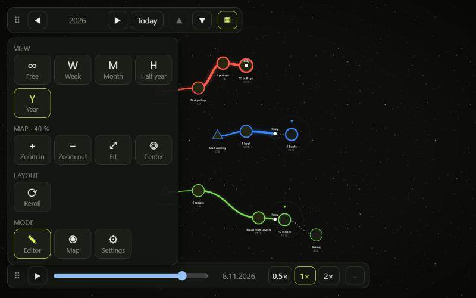
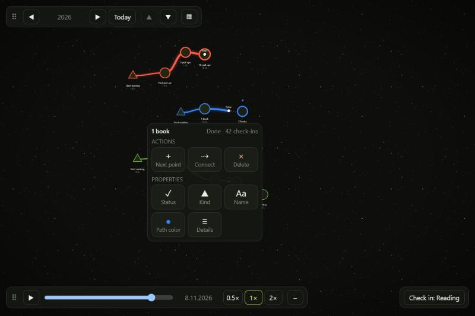

# World of Evolving Paths

Paths with dates that grow stronger the more you walk them. A pannable, zoomable canvas for milestones, branches and goals, drawn with PixiJS. Think skill tree meets milestone calendar: the paths are not fixed, they evolve.

- **A library, not an app.** It stores nothing and prepares no data. Your app hands it objects, it draws them and reports what the user does.
- **Time-aware views.** Show a day, a week, a month, half a year or a year. Each view gets its own data, so a year view can show only the big milestones.
- **Paths that evolve.** Reached connections get wider and start to glow the more often a path is walked: from a desire path to a highway.
- **Points that repel each other.** Dragged points stop where there is room and spring back otherwise. Layouts are generated and stay stable for the same seed.
- **Framework-free core.** The map works on any element. A React binding and ready-made controls are included.

> Status: early (0.0.x). The API can still change.

## The demo

`demo/` is a complete example app: six everyday topics (training, reading, cooking, a game character, a side project, guitar) over two pages, with check-ins that make the paths stronger. Reached connections are wide and lit, open ones are dotted, and the Today marker sits where each path stands. It has an editor mode (everything on) and a map mode (read only, few controls). It holds the data, builds the `PeriodMap` for each view, handles the events and keeps the pinned positions, using only the public API.

```bash
npm install
npm run dev     # http://localhost:5173
```


The main bar stays slim: the period with its arrows, today, the page arrows and one button that opens the tile menu. Everything else is one step away. The menu stays open until you close it.



A selected point gets its own menu with actions (next point, connect, delete) and properties (status, kind, name, path color, details).



Both bars can be dragged to the top or bottom edge, left, middle or right. The map can run left to right, right to left, top to bottom or bottom to top (`orientation`); the map tiles *Turn left* and *Turn right* turn it a quarter at a time.

## Install

```bash
npm install world-of-evolving-paths
```

`pixi.js` is installed with it. React (18 or newer) is an optional peer dependency, needed only for `world-of-evolving-paths/react`.

## Quick start (React)

```tsx
import { periodOf, type PeriodMap } from 'world-of-evolving-paths';
import { PathWorld, ZoomControls } from 'world-of-evolving-paths/react';
import 'world-of-evolving-paths/style.css';

const period = periodOf('week', '2026-11-04');

const periods: PeriodMap = {
  [period.key]: {
    paths: [
      {
        id: 'combat',
        name: 'Combat',
        color: '#ff3b3b',
        points: [
          { id: 'a', date: '2026-11-02', title: 'Sword basics', kind: 'start', status: 'done', next: ['b'] },
          { id: 'b', date: '2026-11-05', title: 'Parry', kind: 'milestone', status: 'current', next: [] },
        ],
      },
    ],
  },
};

export function Example() {
  return (
    <div style={{ width: '100vw', height: '100vh' }}>
      <PathWorld periods={periods} view={period.key}>
        <ZoomControls />
      </PathWorld>
    </div>
  );
}
```

`PathWorld` fills its parent, so give the parent a size.

## Quick start (any framework, or none)

```ts
import { createPathWorld, periodOf } from 'world-of-evolving-paths';
import 'world-of-evolving-paths/style.css';

const handle = createPathWorld(document.getElementById('map')!, { periods, view: period.key });

// Whenever your data or options change:
handle.update({ periods: newPeriods, view: period.key });

// When you remove the element:
handle.destroy();
```

## How it works

You own the data. The library turns what you pass in into a picture and tells you what the user did. It never changes your objects.

```
your app ── periods, view, options ──▶  PathWorld  ──▶  canvas
   ▲                                       │
   └────────── events (onPointMove, ...) ──┘
```

### The objects

**`PathPoint`** is one point on a path.

| Field        | Type                                              | Meaning                                                                            |
| ------------ | ------------------------------------------------- | ---------------------------------------------------------------------------------- |
| `id`         | `string`                                          | Unique within the view.                                                            |
| `date`       | `string`                                          | ISO date `YYYY-MM-DD`. Decides the rough horizontal position.                      |
| `title`      | `string`                                          | Shown under the point.                                                             |
| `kind`       | `'start' \| 'milestone' \| 'crossroad' \| 'goal'` | Start ▲, goal ★, fork ◆ (also when two or more points follow), otherwise ●.        |
| `status`     | `'done' \| 'current' \| 'open' \| 'abandoned'`    | Looks and animation.                                                               |
| `next`       | `string[]`                                        | Ids of the points this one leads to. Draws the connections.                        |
| `importance` | `number` (1–5, optional)                          | Bigger points keep more distance.                                                  |
| `note`       | `string` (optional)                               | Free text for your app.                                                            |
| `strength`   | `number` (0–4, optional)                          | Tier of the connection leading to this point. See [Path strength](#path-strength). |
| `x`, `y`     | `number` (optional)                               | Pins the point. Set both or neither.                                               |

**`Path`** is one graph with its points: `{ id, name, color, lane?, points }`. `color` is `#rrggbb` and stays the same along the whole path. Paths are stacked by `lane` (lowest first), otherwise in list order.

**`PeriodData`** is everything one view needs: `{ paths: Path[] }`. Points can lead to points on other paths with `next`, so paths can branch off and merge. A `next` to a point that is not in the view is dropped. Connections never form a circle: such data is rejected with a message. Point ids may not contain `->`, it separates the ids in the id of a line.

**`PeriodMap`** is a hashmap from period key to `PeriodData`. Typically it holds only the view you show, and you load the next one when the user changes the view.

```ts
const periods: PeriodMap = {
  'week:2026-11-02': { paths }, // the paths of that week, each with its points
  'month:2026-11-01': { paths }, // other points: only the more important ones
};
```

The data is checked when it arrives. Invalid data (a bad date, an unknown path, a duplicate id, ...) is reported through `onError` with a message that says where the problem is, and nothing is drawn. Without `onError` the messages go to `console.error`. `validatePeriodData(data)` runs the same check yourself.

### Views and the calendar

A view is a period of a level: `day`, `week`, `month`, `halfYear` or `year`. Its key is made by the calendar helpers.

```ts
import { periodOf, shiftPeriod, periodFromKey } from 'world-of-evolving-paths';

const week = periodOf('week', '2026-11-04'); // key 'week:2026-11-02', label 'CW 45, 2 Nov – 8 Nov 2026'
const nextWeek = shiftPeriod(week, 1);
const sameWeek = periodFromKey('week:2026-11-02'); // back from a key

periodOf('week', '2026-11-04', { weekStart: 4 }); // weeks that start on a Friday (0 = Monday ... 6 = Sunday)
```

The key decides the calendar span the points are spread over. Any other key (for example `'free'`) is a free view: the points are spread over the span of their own dates.

**What a view shows is up to your app.** The library does not filter. A year view typically gets only the important points, a day view all of them. The demo shows one way to do it (`demo/app-logic/`): filter by period and importance, connect across hidden points, split many paths into pages.

### Layout

You give points without positions and the library lays them out:

- The date decides the rough x position inside the calendar span.
- Each path starts on its lane and drifts with it: upper paths up, middle ones straight, lower ones down.
- Forks push their branches sideways.
- Points keep `radius + radius` from each other and stay off foreign lines. Lines may cross.
- The same input and `seed` always give the same layout. Change `seed` for another one.

**Pinning.** A point with `x` and `y` stays exactly there, the others make room around it. When the user releases a dragged point, `onPointMove` tells you where it came to rest, and `positions` holds every point of the view. Store them and pass them back as `x`/`y` to keep the layout as the user sees it.

### Events

All events are options of `PathWorld` and `createPathWorld`.

| Callback                               | When                                                                                                                 |
| -------------------------------------- | -------------------------------------------------------------------------------------------------------------------- |
| `onSelect(id \| null)`                 | A point was pressed (also when it is then dragged), or the empty area was clicked (`null`).                          |
| `onPointMove({ id, x, y, positions })` | A dragged point was released at its final position.                                                                  |
| `onPointAdd({ x, y, date })`           | The empty area was double-clicked. In a calendar view `date` follows the horizontal position, otherwise it is today. |
| `onError(errors)`                      | The data of the current view is invalid.                                                                             |

Update your data in these callbacks and pass the new objects back in. The data is yours: if you do not answer a move with new data within a moment, the point springs back to where it was. A point that cannot rest where it was dropped (no room, or on a foreign line) springs to the nearest free spot first, and that spot is what onPointMove reports.

### Options

| Option         | Default        | Meaning                                                                                                                                                                                                                                                                                                                           |
| -------------- | -------------- | --------------------------------------------------------------------------------------------------------------------------------------------------------------------------------------------------------------------------------------------------------------------------------------------------------------------------------- |
| `periods`      | —              | The `PeriodMap`.                                                                                                                                                                                                                                                                                                                  |
| `view`         | —              | Key of the period to show.                                                                                                                                                                                                                                                                                                        |
| `today`        | local date     | Today as `YYYY-MM-DD`. Marks "today" on every path.                                                                                                                                                                                                                                                                               |
| `seed`         | `1`            | Changes the generated layout.                                                                                                                                                                                                                                                                                                     |
| `editable`     | `true`         | Allow moving and adding points.                                                                                                                                                                                                                                                                                                   |
| `pointsLocked` | `false`        | Points cannot be dragged.                                                                                                                                                                                                                                                                                                         |
| `wavy`         | `false`        | A slight wave on the lines.                                                                                                                                                                                                                                                                                                       |
| `background`   | black          | `{ pattern: 'stars' \| 'hex' \| 'dots' \| 'none', fill: 'solid' \| 'gradient', base, color, color2, angle, mid, intensity, scale }`.                                                                                                                                                                                              |
| `orientation`  | `'horizontal'` | Which way time runs: `horizontal` (left to right), `horizontal-inverted` (right to left), `vertical` (top to bottom), `vertical-inverted` (bottom to top) or `auto` (vertical while the map is taller than wide, for phones in portrait). Only the picture turns: the data, the positions you store and the events stay the same. |
| `animate`      | `true`         | Flowing dashes, pulsing rings, breathing glow. Off by default for users who prefer reduced motion.                                                                                                                                                                                                                                |
| `locale`       | browser        | Language of the dates under the points, such as `de`.                                                                                                                                                                                                                                                                             |
| `formatDate`   | —              | Writes the date under a point yourself. Wins over `locale`.                                                                                                                                                                                                                                                                       |
| `shortcuts`    | `true`         | Keys `M` (center) and `E` (fit), only while the pointer is over the map or the focus is inside it.                                                                                                                                                                                                                                |

### Camera

Mouse wheel and pinch zoom, drag to pan. When the view changes, the zoom stays and the content is centered. `handle.fit()` fits the content into about 60 % of the viewport, so a frame of empty space stays around it. `handle.center()` and `handle.zoomBy(factor)` do the same from code. With React, put a `ref` on `<PathWorld>` to get the handle (it is `null` until the map exists).

`handle.getDirection()` tells which way time runs right now, also with `orientation: 'auto'`. `rotateDirection(direction, 'left' | 'right')` gives the direction after a quarter turn, so you can build your own turn buttons.

### Dates and language

The date under a point is short, `2.11.` in German, and carries the year only when it is not the current one. Set `locale` (`de`, `en-GB`, `en-US`, ...) to choose the order and separators. Without it the browser's language is used. To write the date yourself, for example with your own date library, pass `formatDate: (iso) => string`.

The labels of periods follow the same language: `periodLabel(period, 'de')` gives `KW 45, 2.11. – 8.11.2026`. `period.label` is the English one.

### Path strength

Paths evolve: the more often a path is walked, the stronger it gets. The library draws the tier you pass in `strength` (0–4) and offers the rule that turns activity into a tier.

**Activity is a check-in: a day on which the path was walked.** Check-ins are not points on the map, so a daily habit does not fill the map. Keep them in your app and pass the day numbers of a path, also those the current view hides:

```ts
import { tierAt, toDay, TIERS } from 'world-of-evolving-paths';

// activityDays: day numbers of the check-ins on this path
const strength = tierAt(activityDays, toDay(point.date));
TIERS[strength]; // { name: 'Highway', width: 13, glow: 0.7 }
```

The tier counts the **active days in the last 12 weeks** up to the date of the point. Several check-ins on one day count once.

| Tier | Name        | Active days in 12 weeks | What it takes                         |
| ---- | ----------- | ----------------------- | ------------------------------------- |
| 0    | Desire path | 0                       | just started                          |
| 1    | Path        | 6                       | about once a week                     |
| 2    | Road        | 18                      | two or three times a week             |
| 3    | Expressway  | 40                      | most days                             |
| 4    | Highway     | 70                      | nearly every day, for about ten weeks |

A highway is a real habit. It shrinks slowly when the habit stops. Pass your own rule as the third argument: `{ weeks, minActiveDays }`.

The strength of a path arrives at its next point: the outline of a reached point is thicker the stronger the path that led to it. The importance of a point is separate. It is your own rating from 1 to 5 and decides the size of the symbol and in which views the point is shown. A strong path does not make a point more important.

Open (future) connections stay thin and dotted. While a point is dragged, thin rings show how much room it keeps.

## Controls (React)

Ready-made controls live in `src/react/controls/`, one folder per control with its own styles. They hold no map logic: they get values and callbacks, so you can restyle or replace them.

| Control           | Folder              | What it does                                                                                                                                                                                                                                                                                                                                                                                                      |
| ----------------- | ------------------- | ----------------------------------------------------------------------------------------------------------------------------------------------------------------------------------------------------------------------------------------------------------------------------------------------------------------------------------------------------------------------------------------------------------------- |
| `ZoomControls`    | `zoom-controls/`    | Zoom out, zoom in, center, fit. Place it inside `PathWorld`.                                                                                                                                                                                                                                                                                                                                                      |
| `ViewBar`         | `view-bar/`         | Level buttons (or one dropdown with `compact`), previous/next period, today, pages, reroll. Holds no state.                                                                                                                                                                                                                                                                                                       |
| `ControlBar`      | `control-bar/`      | A bar docked at the top or bottom edge (`dock`: `top-left`, `top-center`, `top-right`, `bottom-...`). Bars on one edge sit side by side. With `onDockChange` the user drags it to another place, you store it; with `label` it collapses.                                                                                                                                                                         |
| `TilePanel`       | `tile-panel/`       | One button (`▦`) that opens a small panel of tiles in groups, like a number pad. You give the groups and tiles (glyph, label, `active`, `disabled`, `onClick`). It opens away from the edge of its `ControlBar` and stays open until the button is clicked again or Escape is pressed. `ViewBar` with `periodOnly` pairs with it: the period stays in the bar, everything else goes into tiles.                   |
| `SidePanel`       | `side-panel/`       | A panel over the full height at the left or right side, with a close button. Scrolls when long. For settings.                                                                                                                                                                                                                                                                                                     |
| `BackgroundPanel` | `background-panel/` | Fill (plain or gradient with two colors), pattern, brightness and size. Holds no state.                                                                                                                                                                                                                                                                                                                           |
| `PointMenu`       | `point-menu/`       | Tile menu at a selected point. Actions: next point, connect (when you pass `onConnect`), delete. `checkInCount` shows the check-ins of the path under the name. Properties: status, kind, name, path color (with slots for your own colors), details. Sits on the map and moves with it. Placed below the point by default, above when there is no room (`placement`: `auto`, `below`, `above`, `right`, `left`). |
| `Toast`           | `toast/`            | A short message at the top of the map that slides in and goes away by itself (`durationMs`, default 6 s) or when closed. For hints and problems of your app. Holds no state.                                                                                                                                                                                                                                                                                                      |
| `TimeSlider`      | `time-slider/`      | A slider through time with play and pause. Pass its day to the map as `today` and the today markers move along the paths. Holds no state.                                                                                                                                                                                                                                                                         |

Controls that need the map (`ZoomControls`, `PointMenu`) go inside `<PathWorld>`, and so does `ControlBar`. The controls do not position themselves, so you decide what goes where: a bar with everything in the editor, only a zoom control on the published map.

The color slots of `PointMenu` are filled by you: it reports a confirmed color with `onCustomColor`, you remember it and pass the list back in `customColors`.

They emit your callbacks (`onUpdate`, `onAddNext`, `onPathColor`, `onDelete`); you change your data.

`useTimePlayback` moves the day of a `TimeSlider` forward while it plays. `playbackPlan(days, durationMs)` works out the pace so that any range takes the same time, and the slider can show speed buttons (`speeds`, `speed`, `onSpeedChange`). Moving through time only changes `today`, so the points keep their places. Statuses and strengths as of that day are your app's to work out, the demo shows how.

Import `world-of-evolving-paths/style.css` once for the map and the controls. Colors are CSS variables on `.pw-root` (`--pw-bg`, `--pw-ink`, `--pw-lit`, ...).

## Performance

- Pass a **new object for every period that changed** and keep unchanged ones as they are. The map compares periods by reference and recomputes only when one changed. Mutating an object in place is not seen.
- Camera movement and hover never touch React state. Zooming does not re-render your tree.
- Only changed lines and points are redrawn. The map keeps drawing at up to 40 frames per second while something moves on its own (today markers, flowing dashes, the glow). Set `animate: false` to stop that; the map is then only redrawn when something changes. Users who prefer reduced motion get that by default.
- Keep `background` and other object options stable between renders (define them once). They are compared field by field.

## Project layout

```
src/
  core/            Pure logic, no framework, no Pixi, no browser: dates, calendar, layout,
                   collision, strength tiers, validation, scene model, background CSS
  map/             Framework-free map: createPathWorld wires small parts together:
                   engine/ (orientation, framing, keyboard), interaction/ (pointer, gestures,
                   dragging), render/ (Pixi layers), state/ (world model), camera/, dom/
  react/           React binding (PathWorld) and controls
    controls/      One folder per control (see the table above)
    hooks/         One job per hook
demo/              The demo app (not published)
tests/             Cross-cutting tests and fixtures
```

Layers only depend downwards: `core` ← `map` ← `react`. A test (`tests/architecture.test.ts`) enforces this, and that the library never touches `localStorage`.

## Scripts

| Script               | What it does                             |
| -------------------- | ---------------------------------------- |
| `npm run dev`        | Starts the demo.                         |
| `npm test`           | Runs the tests (Vitest).                 |
| `npm run typecheck`  | TypeScript, strict.                      |
| `npm run lint`       | Biome: lint, format check, import order. |
| `npm run format`     | Fixes what Biome can fix.                |
| `npm run build`      | Builds the library into `dist/`.         |
| `npm run build:demo` | Builds the demo into `dist-demo/`.       |

## Not in this version

Undo and redo, and the cascade between week, month and year data, belong in your app by design. Controls are provided for React only; the map itself works with any framework.

### Good to know

- The first layout of a view costs time with many points: about 150 ms for 200 points and well over a second beyond 500, when none of them is pinned. Pinned points cost almost nothing, so store the positions the user chose (see `onPointMove`). Plan on views with a few dozen points.
- Adding a point to a path can widen the tile and move points that are not pinned. Pin points to keep them where they are.
