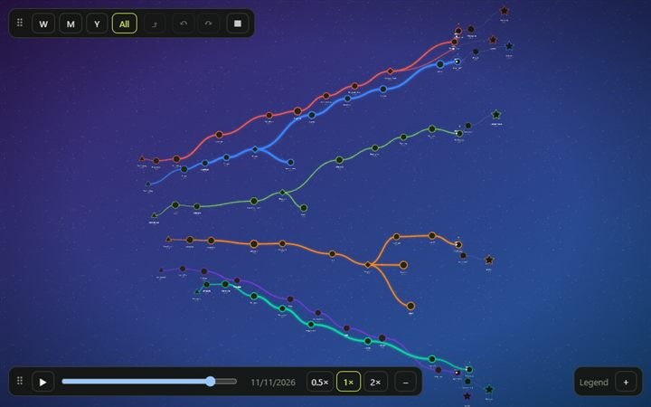
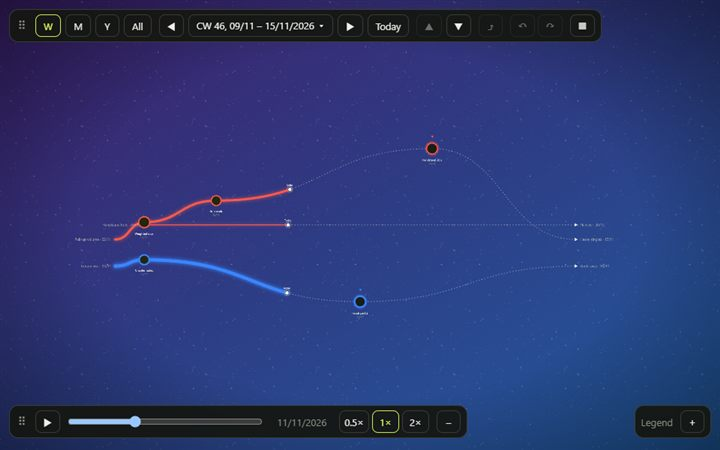

<div align="center">

# 🌱 World of Evolving Paths

**Paths with dates that grow stronger the more you walk them.**
A pannable, zoomable canvas for milestones, branches and goals. Think of a skill tree that is also a milestone calendar. The paths are not fixed: they change as you use them.

[](https://www.npmjs.com/package/world-of-evolving-paths)
[](LICENSE)
[](#-install)
[](https://marcus-koch-fs-dev.github.io/world-of-evolving-paths/)

**[▶ Live demo](https://marcus-koch-fs-dev.github.io/world-of-evolving-paths/)** · [Open in StackBlitz](https://stackblitz.com/github/marcus-koch-fs-dev/world-of-evolving-paths?view=preview) · [Changelog](CHANGELOG.md)

 

</div>

|     |                                                                                                                                                                   |
| --- | ----------------------------------------------------------------------------------------------------------------------------------------------------------------- |
| 📚  | **A library, not an app.** It stores nothing and prepares no data. Your app gives it data, it draws the data and tells you what the user does.                    |
| 🗓️  | **Time-aware views.** Show a day, a week, a month, half a year or one to ten years. Each view gets its own data, so a year view can show only the big milestones. |
| 🛣️  | **Paths that evolve.** Lines you have reached get wider and start to shine the more often you walk the path: from a faint trail to a highway.                     |
| 🧲  | **Points keep their distance.** A dragged point stops where there is room. Otherwise it moves back. The same data and seed always give the same layout.           |
| 🧩  | **Framework-free core.** The map works on any element. A React binding and ready-made controls are included.                                                      |

> Status: early (0.x). The API can still change.

## 📑 Contents

| I want to …                        | Go to                                                 |
| ---------------------------------- | ----------------------------------------------------- |
| install it                         | [📦 Install](#-install)                               |
| see it work in a few lines         | [🚀 Quick start](#-quick-start)                       |
| know where to click in the demo    | [🎮 Using the map](#-using-the-map)                   |
| build it into my app               | [🧩 Building your app](#-building-your-app)           |
| look up an object, event or option | [📚 Reference](#-reference)                           |
| know the limits                    | [📈 Performance and limits](#-performance-and-limits) |
| work on the library itself         | [🔧 Contributing](#-contributing)                     |

## 📦 Install

```bash
npm install world-of-evolving-paths
```

`pixi.js` is installed with it. `react` and `react-dom` (18 or newer) are optional peer dependencies, needed only for `world-of-evolving-paths/react`. The package declares Node.js 24 or newer (`engines`).

## 🚀 Quick start

### With React

```tsx
import { periodOf, type PeriodMap } from 'world-of-evolving-paths';
import { PathWorld, ZoomControls } from 'world-of-evolving-paths/react';
import 'world-of-evolving-paths/style.css';

const period = periodOf('week', '2026-11-04');

// One entry per view: period key → the paths of that view, each with its points
const periods: PeriodMap = {
  [period.key]: {
    paths: [
      {
        id: 'combat',
        name: 'Combat',
        color: '#ff3b3b',
        points: [
          { id: 'a', date: '2026-11-02', title: 'Sword basics', kind: 'start', status: 'done', next: ['b'] },
          { id: 'b', date: '2026-11-05', title: 'Parry', kind: 'milestone', status: 'current', next: [] },
        ],
      },
    ],
  },
};

export function Example() {
  return (
    <div style={{ width: '100vw', height: '100vh' }}>
      <PathWorld periods={periods} view={period.key}>
        <ZoomControls />
      </PathWorld>
    </div>
  );
}
```

> [!NOTE]
> `PathWorld` fills its parent, so give the parent a size.

### Without a framework

```ts
import {
  createPathWorld,
  periodOf,
  type PathWorldOptions,
  type PeriodData,
  type PeriodMap,
  type Position,
} from 'world-of-evolving-paths';

const period = periodOf('week', '2026-11-04');
let periods: PeriodMap = {
  [period.key]: {
    paths: [
      /* your paths, as in the React example */
    ],
  },
};

// The element needs a size, the map fills it
const element = document.getElementById('map')!;

// Pins every point where the user sees it, as a new object
const pinned = (data: PeriodData, positions: Record<string, Position>): PeriodData => ({
  paths: data.paths.map((path) => ({
    ...path,
    points: path.points.map((point) => ({ ...point, ...positions[point.id] })),
  })),
});

const options = (): PathWorldOptions => ({
  periods,
  view: period.key,
  onPointMove: ({ positions }) => {
    // Store the positions, then pass a new object back in (see Events)
    periods = { ...periods, [period.key]: pinned(periods[period.key], positions) };
    handle.update(options());
  },
});

const handle = createPathWorld(element, options());

// When you remove the element:
handle.destroy();
```

> [!IMPORTANT]
> **`handle.update(options)` replaces all options, it does not merge them.** Always pass the full set, callbacks included. An option you leave out is gone: without `onPointMove` a dragged point moves back. The easiest way is one function that builds the options, as above.

The stylesheet is only needed for the React binding and its controls. The map itself sets the styles of its element in code (inline styles).

## 🎮 Using the map

The [live demo](https://marcus-koch-fs-dev.github.io/world-of-evolving-paths/) shows what the library can do. This is where to click.

**Points**

| I want to …                      | Do this                                                                                                                                                                      |
| -------------------------------- | ---------------------------------------------------------------------------------------------------------------------------------------------------------------------------- |
| Select a point and open its menu | Click it. Click the empty area to deselect.                                                                                                                                  |
| Move a point                     | Drag it up or down. It stays on its date, so it only moves across the time axis. It keeps that height in every view. It stops where there is room, otherwise it moves back.  |
| Add a point                      | Double-click the empty area. It joins the path of the selected point, or the first path. The new point gets the importance the current view needs, so you see it right away. |
| Add the next point               | Point menu → **Next point** → name and date → **Create**.                                                                                                                    |
| Start a **new path**             | Point menu → **Next point** → tick **On a new path (own color)**, give the path a name (optional) and pick a color → **Create**.                                             |
| Connect two points               | Point menu → **Connect**, then click the point to connect to. Escape cancels.                                                                                                |
| Change status, kind, name, color | Point menu → **Properties**: Status, Kind, Name, Path color.                                                                                                                 |
| Delete a point                   | Point menu → **Delete**. The path stays connected: the point before and the point after are joined.                                                                          |
| Point hidden after a change      | If you lower the importance of a point, the view may no longer show it. A message says which view shows it, and its button goes there.                                       |

**Lines**

| I want to …                  | Do this                                                                                                                                                                      |
| ---------------------------- | ---------------------------------------------------------------------------------------------------------------------------------------------------------------------------- |
| Insert a point into a line   | Click or right-click the line → **Insert point**. The new point sits between the two points, on the date where you clicked.                                                  |
| Move a line                  | Drag the arrow at its end, at the edge of the view, up or down. A line without a point in the view moves as a whole. A line from a point moves only its end at the edge.     |
| Keep the height of a line    | Nothing to do. The height is kept for that connection, in every view.                                                                                                        |
| See a path that skips a view | A path with points before and after the period, but none inside, runs across the whole view, with the names and dates at both ends. At a fork each branch gets its own line. |
| Keep lines apart             | Nothing to do. Lines that would lie on top of each other move apart by themselves.                                                                                           |

**Paths grow**

| I want to …             | Do this                                                                                     |
| ----------------------- | ------------------------------------------------------------------------------------------- |
| Check in on a path      | Select a point of the path, then the **Check in** button at the bottom right. Once per day. |
| See what a check-in did | A message at the top shows the active days before and after and what the next tier needs.   |
| Undo or redo            | The arrow buttons in the top bar, or Ctrl+Z and Ctrl+Y. Up to 100 steps, kept in memory.    |

**Moving around**

| I want to …              | Do this                                                                                                                                                                                                             |
| ------------------------ | ------------------------------------------------------------------------------------------------------------------------------------------------------------------------------------------------------------------- |
| Zoom                     | Mouse wheel or pinch.                                                                                                                                                                                               |
| Pan                      | Drag the empty area.                                                                                                                                                                                                |
| Center / fit everything  | Keys **M** and **E** while the pointer is over the map, or the buttons (tiles) in the menu.                                                                                                                         |
| Change the level         | The chips **W** (week), **M** (month), **Y** (year) and **All** in the top bar, or the keys W, M, Y and A.                                                                                                          |
| Show several years       | In the year view, the counter **− 1 +** next to the chips: 1, 2, 5 or 10 years. The keys + and − do the same.                                                                                                       |
| Change the period        | The arrows ◀ ▶ on both sides of the period, or the arrow keys ← →. **Today** (key T) goes to the week of today.                                                                                                     |
| Pick a period directly   | Click the period in the top bar (for example "2026 ▾"). A list opens with the weeks, months and years. The view jumps to the one you pick.                                                                          |
| See which points show    | The **Legend** in the corner (closed at first). It shows, for each importance, from which view on such a point appears.                                                                                             |
| Snap to a grid           | Menu (▦) → **Mode** → Settings → **Snap to grid**. Dragged and added points then sit on a grid.                                                                                                                     |
| Go one level deeper      | Double-click a point. From the year you go to the month, then the week.                                                                                                                                             |
| See where a path goes on | At the start and end of a view, a line leaves the point towards the edge. At its end you read the name and date of the next or earlier point. Double-click the line or its text to go there. **⤴** brings you back. |
| Go back                  | The **⤴** button in the top bar. It returns to the view before the last double-click.                                                                                                                               |
| Travel through time      | The time slider at the bottom (on a small screen the bar starts closed, open it with **+**). **Play** runs through the days of the view.                                                                            |
| Turn the map             | Menu (▦) → **Map** → Turn left / Turn right.                                                                                                                                                                        |
| Change the background    | Menu (▦) → **Mode** → Settings.                                                                                                                                                                                     |
| Switch to read-only      | Menu (▦) → **Mode** → Map. The editor mode has everything on.                                                                                                                                                       |

> [!TIP]
> Both bars can be dragged to the top or bottom edge, left, middle or right. Everything on the bars is built from the controls of the library, see [Controls](#controls-react).

## 🧩 Building your app

You own the data. The library turns what you pass in into a picture and tells you what the user did. It never changes your objects.

```
your app ── periods, view, options ──▶  PathWorld  ──▶  canvas
   ▲                                       │
   └────────── events (onPointMove, ...) ──┘
```

> [!NOTE]
> **The library stores nothing.** Undo, saving and loading are your app's job. The demo shows one way in `demo/app-logic/`.

### Show a view

A view is a period of a level: `day`, `week`, `month`, `halfYear` or `year`. Its key is made by the calendar helpers, and `periods` holds the data of each key.

```ts
import { periodOf, shiftPeriod, periodFromKey } from 'world-of-evolving-paths';

const week = periodOf('week', '2026-11-04'); // key 'week:2026-11-02', label 'CW 45, 2 Nov – 8 Nov 2026'
const nextWeek = shiftPeriod(week, 1);
const sameWeek = periodFromKey('week:2026-11-02'); // back from a key

periodOf('week', '2026-11-04', { weekStart: 4 }); // weeks that start on a Friday (0 = Monday ... 6 = Sunday)
periodOf('year', '2026-11-04', { years: 5 }); // key 'year:2022-01-01+5', label '2022–2026': 1 to 10 years, ending with the year of the date
```

```ts
const periods: PeriodMap = {
  'week:2026-11-02': { paths }, // the paths of that week, each with its points
  'month:2026-11-01': { paths }, // other points: only the more important ones
};
```

- The key decides the calendar span the points are spread over. Any other key (for example `'free'`) is a free view: the points are spread over the span of their own dates.
- **What a view shows is up to your app.** The library does not filter. A year view typically gets only the important points, a day view all of them. The demo shows one way to do it (`demo/app-logic/`): filter by period and importance, connect across hidden points, split many paths into pages.
- Typically `periods` holds only the view you show, and you load the next one when the user changes the view.
- If `periods` has no entry for `view`, the map stays empty and reports nothing, so make sure the view you show has data.

### Show where a path comes from and goes

A view shows only some points. A point at the start of the period has a path that came from before, and the last point has a path that goes on after. Without a hint it looks as if the path ended there, and that looks like a mistake.

Tell the map about those connections with `incoming` and `outgoing` on the point. Each entry has the `title` and the `date` of the point out there, and its `id` if your app wants to go there:

```ts
const point = {
  id: 'pull-up',
  date: '2026-03-23',
  title: '5 pull-ups',
  kind: 'milestone',
  status: 'done',
  next: [],
  incoming: [{ title: 'First pull-up', date: '2026-02-09', id: 'first' }], // the path comes from here
  outgoing: [{ title: '10 pull-ups', date: '2026-06-08', id: 'ten' }], // and goes on to here
};
```

The map draws a line from the point towards the edge of the view. At its end sits an arrow that points out of the view, with the title and date next to it. The arrow and the text get bigger and brighter when the pointer is on the line, so it is clear that you can click it. The line looks like the path: wide when it was walked, dotted when it is still ahead. A point can have several, for example at a fork.

A double-click on the line or its text calls `onLeadDoubleClick({ pointId, side, title, date, id })`. Your app decides what happens. The demo goes to the period of that date, in the same level, and selects the point out there. The **Back** button returns.

Sometimes a path has points before and after the period, but none inside it. Pass such a connection in `through` on the path: `{ from, to, strength?, y? }`, where `from` and `to` look like an entry of `incoming`. The map draws a line across the whole view, with an arrow, the title and the date at each end. At a fork, give one entry per branch.

The map does not look for these points itself, because it only knows the points of this view. Your app finds them when it builds the view. The demo does it in `demo/app-logic/leads.ts`: it follows the connections over hidden points until it reaches the first point outside the period.

### Keep the layout

You give points without positions and the library lays them out:

- The date decides the rough x position inside the calendar span.
- Each path has a lane (its row). Paths in upper lanes bend up, middle ones stay straight, lower ones bend down.
- Where a path splits, the branches move apart.
- Points keep `radius + radius` from each other and stay off foreign lines. Lines may cross.
- The same input and `seed` always give the same layout. Change `seed` for another one.

**Fixing a position (pinning).** A point with `x` and `y` stays exactly there, the others make room around it. A point with only `y` keeps its height and sits on its date along the time axis. That is the way to keep a height in every view, because the date gives a different `x` in a week than in a year. When the user drops a dragged point, `onPointMove` tells you where it ended up, and `positions` holds every point of the view. Store them and pass them back to keep the layout as the user sees it.

By default a dragged point moves only across the time axis (`timeLocked: true`), so it always stays on its date and agrees with the marker for today. Set `timeLocked: false` to let it move freely. With `snap` (a distance in world units) dragged and added points sit on a grid.

**Lines the user moves.** Lines that run along the time axis (the lines that leave the view and the ones in `through`) keep apart from each other by themselves. The user can drag the arrow at the end of such a line up or down. `onLineEndMove({ from, to, y })` then tells you the two points of that connection and the new height. Store it and pass it back as `y` on the lead (in `incoming` or `outgoing`) or on the entry in `through`. The line stays where it was dragged until your new data arrives.

**Clicking a line.** `onLineSelect({ from, to, x, y, date, at })` comes when the user clicks or right-clicks a line: a connection between two points, a line that leaves the view, or one that spans it. `from` and `to` are its two ends (`{ id?, title, date }`), `date` is the date where it was clicked. Show a `LineMenu` at `at`, for example with **Insert point**. The demo inserts a point there and puts it between the two points in `next`.

> [!WARNING]
> Answer a move with a **new** `PeriodData` object within 80 ms, otherwise the point moves back. Changing the old object in place does not count, the map compares by reference. See [Events](#events).

### Add points and paths

- The user double-clicks the empty area: `onPointAdd({ x, y, date })` tells you where. You decide whether and how to add a point.
- The user double-clicks a point: `onPointDoubleClick({ id, date })` tells you which one. The demo uses it to go one level deeper, to the period of that date.
- The `PointMenu` control has a **Next point** panel. It calls your `onAddNext({ title, date, newPath, color, pathName })`. With `newPath` you create a new `Path` with that color and `pathName` (if empty, use the title) and put the point on it. Without it, the point joins the path of the selected point.
- A new path is just another entry in `paths`. Give it an `id`, a `name`, a `color` and its points.

### Make paths stronger

The more often a path is walked, the stronger it gets. The library draws the tier you pass in `strength` (0–4) and offers the rule that turns activity into a tier.

**Activity is a check-in: a day on which the path was walked.** Check-ins are not points on the map, so a daily habit does not fill the map. Keep them in your app. Pass the day numbers of a path, including days the current view hides:

```ts
import { tierAt, toDay, TIERS } from 'world-of-evolving-paths';

// The days on which this path was walked, as day numbers
const activityDays = checkInDates.map(toDay); // checkInDates: ['2026-11-02', '2026-11-04', ...]
const strength = tierAt(activityDays, toDay(point.date));
TIERS[strength]; // { name: 'Highway', width: 13, glow: 0.7 }
```

The tier counts the **active days in the last 12 weeks** up to the date of the point. Several check-ins on one day count once.

| Tier | Name        | Active days in 12 weeks | What it takes                         |
| ---- | ----------- | ----------------------- | ------------------------------------- |
| 0    | Desire path | 0                       | just started, a faint trail           |
| 1    | Path        | 6                       | about once a week                     |
| 2    | Road        | 18                      | two or three times a week             |
| 3    | Expressway  | 40                      | most days                             |
| 4    | Highway     | 70                      | nearly every day, for about ten weeks |

A highway is a real habit. It shrinks slowly when the habit stops. Pass your own rule as the third argument: `{ weeks, minActiveDays }`.

The strength of a path arrives at its next point: the border of a reached point is thicker the stronger the path that led to it. The importance of a point is separate. It is your own rating from 1 to 5 and decides the size of the symbol and the room it keeps. Your app can also use it to decide which views show the point (the demo does). A strong path does not make a point more important.

Lines to points that are not reached yet stay thin and are drawn with dots. While a point is dragged, thin rings show how much room it needs.

### Dates and language

The date under a point is short, `2.11.` in German, and carries the year only when it is not the current one. Set `locale` (`de`, `en-GB`, `en-US`, ...) to choose the order and separators. Without it the browser's language is used. To write the date yourself, for example with your own date library, pass `formatDate: (iso) => string`.

The labels of periods follow the same language: `periodLabel(period, 'de')` gives `KW 45, 2.11. – 8.11.2026`. `period.label` is the English one.

### Camera and direction of time

Mouse wheel and pinch zoom, drag to pan. When the view changes, the zoom stays and the content is centered. `handle.fit()` fits the content into about 60 % of the viewport, so a frame of empty space stays around it. `handle.center()` and `handle.zoomBy(factor)` do the same from code. With React, put a `ref` on `<PathWorld>` to get the handle (it is `null` until the map exists).

The option `orientation` sets which way time runs: `horizontal` (left to right), `horizontal-inverted` (right to left), `vertical` (top to bottom), `vertical-inverted` (bottom to top) or `auto` (vertical when the map is taller than wide, good for phones). Only the picture turns. Your data, the positions you store and the events stay the same.

`handle.getDirection()` tells which way time runs right now, also with `orientation: 'auto'`. `rotateDirection(direction, 'left' | 'right')` gives the direction after a quarter turn, so you can build your own turn buttons.

## 📚 Reference

### Objects

**`PathPoint`** is one point on a path.

| Field        | Type                                              | Meaning                                                                                                                                                                                         |
| ------------ | ------------------------------------------------- | ----------------------------------------------------------------------------------------------------------------------------------------------------------------------------------------------- |
| `id`         | `string`                                          | Unique within the view.                                                                                                                                                                         |
| `date`       | `string`                                          | ISO date `YYYY-MM-DD`. Decides the rough horizontal position.                                                                                                                                   |
| `title`      | `string`                                          | Shown under the point.                                                                                                                                                                          |
| `kind`       | `'start' \| 'milestone' \| 'crossroad' \| 'goal'` | Start ▲, goal ★, fork ◆ (also when two or more points follow), otherwise ●.                                                                                                                     |
| `status`     | `'done' \| 'current' \| 'open' \| 'abandoned'`    | Looks and animation.                                                                                                                                                                            |
| `next`       | `string[]`                                        | Ids of the points this one leads to. Draws the connections.                                                                                                                                     |
| `importance` | `number` (1–5, optional)                          | Bigger points keep more distance.                                                                                                                                                               |
| `note`       | `string` (optional)                               | Free text for your app.                                                                                                                                                                         |
| `strength`   | `number` (0–4, optional)                          | Tier of the connection leading to this point. See [Make paths stronger](#make-paths-stronger).                                                                                                  |
| `incoming`   | `{ title, date, id?, y? }[]` (optional)           | Points outside this view that lead to this point. The map draws a line from the edge, with title and date. See [Show where a path comes from and goes](#show-where-a-path-comes-from-and-goes). |
| `outgoing`   | `{ title, date, id?, y? }[]` (optional)           | Points outside this view that this point leads to. The map draws a line to the edge, with title and date. `y` is the height of the line at the edge (see `onLineEndMove`).                      |
| `x`, `y`     | `number` (optional)                               | Pins the point. Both: exactly there. Only `y`: at this height, on its date. `x` needs `y`.                                                                                                      |

**`Path`** is one graph with its points: `{ id, name, color, lane?, points, through? }`. `through` lists the connections that span the whole period without a point inside (`PathThrough`, see [Show where a path comes from and goes](#show-where-a-path-comes-from-and-goes)). `color` is `#rrggbb` and stays the same along the whole path. Paths are placed one below the other by `lane` (lowest number first), otherwise in list order.

**`PeriodData`** is everything one view needs: `{ paths: Path[] }`. Points can lead to points on other paths with `next`, so paths can branch off and merge. A `next` to a point that is not in the view is dropped. Connections never form a circle: such data is rejected with a message. Point ids may not contain `->`, it separates the ids in the id of a line.

**`PeriodMap`** is an object that maps a period key to its `PeriodData`.

The data is checked when it arrives. Invalid data (a bad date, a duplicate id, a circle of connections, ...) is reported through `onError`. The message says where the problem is, and nothing is drawn. Without `onError` the messages go to `console.error`. `validatePeriodData(data)` runs the same check yourself.

### Events

All events are options of `PathWorld` and `createPathWorld`.

| Callback                                                | When                                                                                                                                                                                                                                            |
| ------------------------------------------------------- | ----------------------------------------------------------------------------------------------------------------------------------------------------------------------------------------------------------------------------------------------- |
| `onSelect(id \| null)`                                  | A point was pressed (also when it is then dragged), or the empty area was clicked (`null`).                                                                                                                                                     |
| `onPointMove({ id, x, y, positions })`                  | A dragged point was released at its final position.                                                                                                                                                                                             |
| `onPointAdd({ x, y, date })`                            | The empty area was double-clicked. In a calendar view `date` follows the horizontal position, otherwise it is today. `x`/`y` are map coordinates (not screen pixels), already moved to a free spot.                                             |
| `onPointDoubleClick({ id, date })`                      | A point was double-clicked. `date` is the date of the point. Your app decides what happens, for example a finer view.                                                                                                                           |
| `onLeadDoubleClick({ pointId, side, title, date, id })` | A line that leaves the view was double-clicked, on its text or on the line. `side` is `'before'` for a line that comes from outside and `'after'` for one that goes on. `title`, `date` and `id` are what you gave in `incoming` or `outgoing`. |
| `onLineSelect({ from, to, x, y, date, at })`            | A line was clicked or right-clicked. `from` and `to` are its ends, `x`/`y`/`date` the place on the line, `at` the place for a `LineMenu`. See [Keep the layout](#keep-the-layout).                                                              |
| `onLineEndMove({ from, to, y })`                        | The arrow at the end of a line that leaves or spans the view was dragged and let go. Pass `y` back on the lead or on the `through` entry.                                                                                                       |
| `onError(errors)`                                       | The data of the current view is invalid, or an option such as `today`, `locale` or a background color is invalid (it is then replaced by its default).                                                                                          |

Update your data in these callbacks and pass the new objects back in. The data is yours. If you do not answer a move within 80 ms with a **new** `PeriodData` object for the current view, the point moves back to where it was. Changing the old object in place does not count, the map compares by reference. Sometimes a point cannot stay where it was dropped (no room, or on a foreign line). Then it moves back along its way until it finds a free spot. That spot is what `onPointMove` reports.

### Options

**Copy this object.** It lists every option of `PathWorld` and `createPathWorld` with its default value. Only `periods` and `view` are needed, so you can delete every other line.

```ts
import type { PathWorldOptions } from 'world-of-evolving-paths';

const options: PathWorldOptions = {
  periods, // required: the PeriodMap
  view: period.key, // required: the key of the period to show
  today: '2026-11-10', // default: today's local date
  seed: 1, // another number gives another layout
  editable: true, // false: no moving and no adding of points
  pointsLocked: false, // true: points cannot be dragged
  timeLocked: true, // false: a dragged point may leave its date
  // snap: 40, // no default: dragged and added points snap to a grid with this distance
  wavy: false, // true: a slight wave on the lines
  animate: true, // false: no moving parts (also the default for users who prefer reduced motion)
  orientation: 'horizontal', // 'horizontal-inverted' | 'vertical' | 'vertical-inverted' | 'auto'
  locale: 'en-GB', // default: the language of the browser
  shortcuts: true, // keys M (center) and E (fit)
  background: {
    // every value here is the default
    fill: 'solid', // or 'gradient'
    pattern: 'none', // or 'stars' | 'hex' | 'dots'
    base: '#0e0f0c', // base color
    color: '#edefe6', // color of the pattern
    color2: '#1d3a4a', // second color of the gradient
    angle: 180, // direction of the gradient in degrees
    mid: 50, // middle of the gradient in percent
    intensity: 0.5, // brightness of the pattern, 0 to 1
    scale: 1, // size of the pattern, 0.5 to 2
  },
  // formatDate: (iso) => iso, // no default: write the date under a point yourself
  // The events, all optional (see Events above):
  // onSelect, onPointMove, onPointAdd, onPointDoubleClick, onLeadDoubleClick, onLineSelect, onLineEndMove, onError
};
```

**What the demo editor starts with.** These are the values of the live demo when you open it for the first time. The demo keeps some of them in the browser (levels, direction, language, background and the place of the bars).

```ts
const demoEditorAtStart = {
  mode: 'editor', // 'map' is read only, with few controls
  view: 'year', // the first view; 'free' shows everything
  levels: ['week', 'month', 'year'], // the chips in the top bar
  years: 1, // how many years the year view spans: 1, 2, 5 or 10
  settings: {
    wavy: false,
    pointsLocked: false,
    snap: false,
    animate: true,
    orientation: 'auto',
    locale: 'the language of the browser', // fallback: 'en-GB'
  },
  background: { fill: 'gradient', base: '#3a1f6b', color2: '#1f5a9e', angle: 150, pattern: 'stars', intensity: 0.5 },
  bars: { main: 'top-left', time: 'bottom-left' }, // the user can drag both bars to another place
  seed: 1,
  customColors: [], // colors the user saved in the color picker
};
```

The `PointMenu` has options too. These are the defaults:

```tsx
<PointMenu
  point={point}
  path={path}
  onUpdate={onUpdate}
  onAddNext={onAddNext}
  onPathColor={onPathColor}
  onDelete={onDelete}
  canComplete // true: false while earlier points are not done yet
  importanceRange={[1, 5]}
  placement="auto" // 'below' | 'above' | 'right' | 'left'
  hide={[]} // tiles to leave out: 'status' | 'next' | 'connect' | 'kind' | 'color' | 'rename' | 'details' | 'remove'
  // colors={PATH_PALETTE}, customColors, onCustomColor, onConnect, connecting, checkInCount: no default
/>;
```

<details>
<summary><b>The same options as a table, with an explanation of each</b> (click to open)</summary>

| Option         | Default        | Meaning                                                                                                                                                                                                                             |
| -------------- | -------------- | ----------------------------------------------------------------------------------------------------------------------------------------------------------------------------------------------------------------------------------- |
| `periods`      | —              | The `PeriodMap`.                                                                                                                                                                                                                    |
| `view`         | —              | Key of the period to show.                                                                                                                                                                                                          |
| `today`        | local date     | Today as `YYYY-MM-DD`. Marks "today" on the lines, only in a view that holds it.                                                                                                                                                    |
| `seed`         | `1`            | Changes the generated layout.                                                                                                                                                                                                       |
| `editable`     | `true`         | Allow moving and adding points.                                                                                                                                                                                                     |
| `pointsLocked` | `false`        | Points cannot be dragged.                                                                                                                                                                                                           |
| `timeLocked`   | `true`         | A dragged point moves only across the time axis and stays on its date.                                                                                                                                                              |
| `snap`         | —              | Distance of a grid in world units. Dragged and added points snap to it.                                                                                                                                                             |
| `wavy`         | `false`        | A slight wave on the lines.                                                                                                                                                                                                         |
| `background`   | dark, plain    | `{ pattern: 'stars' \| 'hex' \| 'dots' \| 'none', fill: 'solid' \| 'gradient', base, color, color2, angle, mid, intensity, scale }`.                                                                                                |
| `orientation`  | `'horizontal'` | Which way time runs: `horizontal`, `horizontal-inverted`, `vertical`, `vertical-inverted` or `auto`. See [Camera and direction of time](#camera-and-direction-of-time). Only the picture turns, your data and events stay the same. |
| `animate`      | `true`         | Moving dashes, pulsing rings and a soft pulsing light. Off by default for users who prefer reduced motion.                                                                                                                          |
| `locale`       | browser        | Language of the dates under the points, such as `de`.                                                                                                                                                                               |
| `formatDate`   | —              | Writes the date under a point yourself. It is used instead of `locale`.                                                                                                                                                             |
| `shortcuts`    | `true`         | Keys `M` (center) and `E` (fit), only while the pointer is over the map or the focus is inside it.                                                                                                                                  |

</details>

### Controls (React)

Ready-made controls are imported from `world-of-evolving-paths/react`. In the repository they live in `src/react/controls/`, one folder per control with its own styles; their props are typed, so your editor shows what each one needs. They hold no map logic: they get values and callbacks, so you can restyle or replace them.

<details>
<summary><b>All controls</b> (click to open)</summary>

| Control           | What it does                                                                                                                                                                                                                                                                                                                                                                                                                         |
| ----------------- | ------------------------------------------------------------------------------------------------------------------------------------------------------------------------------------------------------------------------------------------------------------------------------------------------------------------------------------------------------------------------------------------------------------------------------------ |
| `ZoomControls`    | Zoom out, zoom in, center, fit. Place it inside `PathWorld`.                                                                                                                                                                                                                                                                                                                                                                         |
| `ViewBar`         | Level buttons (or one dropdown with `compact`), previous/next period, today, pages, reroll. With `onDateChange` (and `date`) a click on the period opens a date picker. Holds no state. `levelChips` keeps the level buttons with `periodOnly`, `freeLast` puts the free view after the levels, `afterLevels` and `periodSlot` take your own controls (for example a counter of years and a period picker).                          |
| `ControlBar`      | A bar fixed to the top or bottom edge (`dock`: `top-left`, `top-center`, `top-right`, `bottom-...`). Bars on one edge sit side by side. With `onDockChange` the user drags it to another place, you store it; with `label` it can be folded.                                                                                                                                                                                         |
| `TilePanel`       | One button (`▦`) that opens a small panel of buttons (tiles) in groups, like a number pad. You give the groups and tiles (glyph, label, `active`, `disabled`, `onClick`). It opens away from the edge of its `ControlBar` and stays open until the button is clicked again or Escape is pressed. `ViewBar` with `periodOnly` pairs with it: the period stays in the bar, everything else goes into tiles.                            |
| `SidePanel`       | A panel over the full height at the left or right side, with a close button. Scrolls when long. For settings.                                                                                                                                                                                                                                                                                                                        |
| `BackgroundPanel` | Fill (plain or gradient with two colors), pattern, brightness and size. Holds no state.                                                                                                                                                                                                                                                                                                                                              |
| `PointMenu`       | Menu with buttons at a selected point. Actions: next point, connect (needs `onConnect`), delete. Properties: status, kind, name, path color (with slots for your own colors) and details. The menu shows the name of the path of the point. `checkInCount` shows the check-ins of the path. It moves with the map and sits below the point, or above when there is no room (`placement`: `auto`, `below`, `above`, `right`, `left`). |
| `Toast`           | A short message at the top of the map that slides in and goes away by itself (`durationMs`, default 6 s) or when closed. For hints and problems of your app. With `action` it shows a button. Holds no state.                                                                                                                                                                                                                        |
| `LineMenu`        | Tile menu at a clicked line, in the look of `PointMenu`. Place it inside `PathWorld` at `at` of `onLineSelect`; you give the title and the tiles.                                                                                                                                                                                                                                                                                    |
| `TimeSlider`      | A slider through time with play and pause. Pass its day to the map as `today` and the today markers move along the paths. Holds no state.                                                                                                                                                                                                                                                                                            |

</details>

- Controls that need the map (`ZoomControls`, `PointMenu`) go inside `<PathWorld>`, and so does `ControlBar`. The controls do not position themselves, so you decide what goes where: a bar with everything in the editor, only a zoom control on the published map.
- The color slots of `PointMenu` are filled by you: it reports a confirmed color with `onCustomColor`, you remember it and pass the list back in `customColors`.
- `PointMenu` calls your callbacks (`onUpdate`, `onAddNext`, `onPathColor`, `onDelete`); you change your data.
- `useTimePlayback` moves the day of a `TimeSlider` forward while it plays. `playbackPlan(days, durationMs)` works out the pace so that any range takes the same time, and the slider can show speed buttons (`speeds`, `speed`, `onSpeedChange`). Moving through time only changes `today`, so the points keep their places. Statuses and strengths as of that day are your app's to work out, the demo shows how.
- With React, import `world-of-evolving-paths/style.css` once for `PathWorld` and the controls. Colors are CSS variables on `.pw-root` (`--pw-bg`, `--pw-ink`, `--pw-lit`, ...), the class `PathWorld` puts on its element.

### More exports

Besides what is shown above, the package exports helpers you may want for your own controls: `usePathWorldHandle`, `useCameraZoom` and `useWorldVersion` for React; `positionOf`, `getCamera` and `subscribeCamera` on the handle; and constants and functions such as `VIEW_LEVELS`, `PATH_PALETTE`, `BACKGROUND_DEFAULTS`, `STRENGTH_RULE`, `tierOf`, `activeDaysIn`, `fromDay`, `todayLocal` and `symbolSize`. All of them are typed, so your editor shows how to use them.

## 📈 Performance and limits

- Pass a **new object for every period that changed** and keep unchanged ones as they are. The map compares periods by reference and calculates again only when one changed. Changing an object in place is not noticed.
- Camera movement and hover never touch React state. Zooming does not re-render your tree.
- Only changed lines and points are redrawn. The map keeps drawing at up to 40 frames per second while something moves on its own (today markers, moving dashes, the soft light). Set `animate: false` to stop that; the map is then only redrawn when something changes. Users who prefer reduced motion get that by default.
- Keep `background` and other object options stable between renders (define them once). They are compared field by field.
- The first layout of a view costs time with many points: about 150 ms for 200 points and well over a second beyond 500, when none of them is pinned. Pinned points cost almost nothing, so store the positions the user chose (see `onPointMove`). Plan on views with a few dozen points.
- Adding a point to a path can make the view wider and move points that are not pinned. Pin points to keep them where they are.

### Not in this version

Undo and redo belong in your app, and so does passing changes on between week, month and year data. The library never changes your data. The demo shows one way to do undo and redo (`demo/app-logic/history.ts`). Controls are provided for React only; the map itself works with any framework.

## 🔧 Contributing

### Run the demo

`demo/` is a complete example app: six everyday topics over one year, two paths per page, with check-ins that make the paths stronger. It holds the data, builds the `PeriodMap` for each view, handles the events and keeps the pinned positions, using only the public API.

```bash
npm install
npm run dev     # http://localhost:5173
```

### Scripts

| Script               | What it does                             |
| -------------------- | ---------------------------------------- |
| `npm run dev`        | Starts the demo.                         |
| `npm test`           | Runs the tests (Vitest).                 |
| `npm run typecheck`  | TypeScript, strict.                      |
| `npm run lint`       | Biome: lint, format check, import order. |
| `npm run format`     | Fixes what Biome can fix.                |
| `npm run build`      | Builds the library into `dist/`.         |
| `npm run build:demo` | Builds the demo into `dist-demo/`.       |

### Project layout

```
src/
  core/            Pure logic, no framework, no Pixi, no browser: dates, calendar, layout,
                   collision, strength tiers, validation, scene model, background CSS
  map/             Framework-free map: createPathWorld wires small parts together:
                   engine/ (orientation, framing, keyboard), interaction/ (pointer, gestures,
                   dragging), render/ (Pixi layers), state/ (world model), camera/, dom/
  react/           React binding (PathWorld) and controls
    controls/      One folder per control (see the table above)
    hooks/         One job per hook
demo/              The demo app (not published)
tests/             Cross-cutting tests and fixtures
```

Layers only depend downwards: `core` ← `map` ← `react`. A test (`tests/architecture.test.ts`) enforces this, and that the library never touches `localStorage`.

## 📝 Changelog

What changed in each version: [CHANGELOG.md](CHANGELOG.md).
